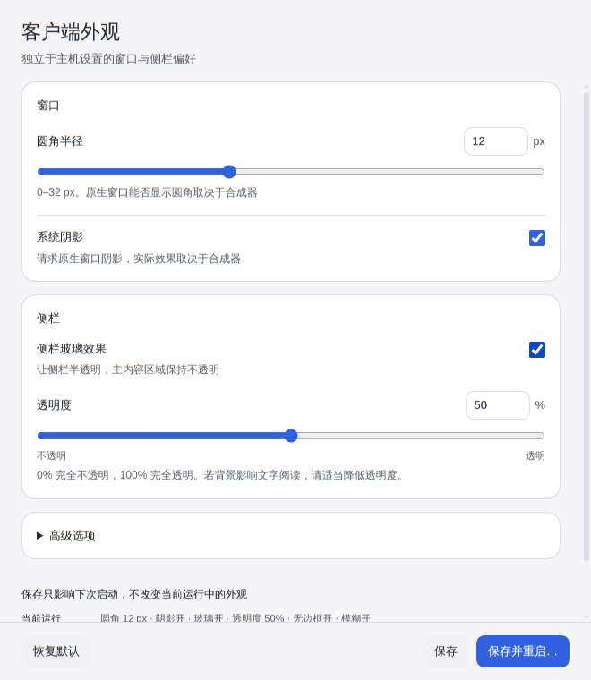

# dsh-desktop-linux

[中文](README.md) | **English**

Ports the **packaging pipeline** of the official [DeepSeek Harness](https://github.com/deepseek-ai/deepseek-harness) desktop app (the Electron application in `apps/desktop`) to Linux, producing AppImage / deb / rpm / Arch packages.

Upstream does not support Linux today; this project adds `linux-x64` and `linux-arm64` targets to the official packaging pipeline.

This fork’s `feature/kde-client-settings` branch also provides independent client appearance settings and combines frameless windows, sidebar glass, rounded corners, and system shadows. **These features are source-only in this fork; no release package containing them has been published.** Downloads from the original project below do not imply these features are included.


*Window and sidebar preferences are saved separately and apply after restart; see [Client appearance](docs/client-appearance.en.md)*

## What this project produces

What this project ships is **the official Electron application itself**:

- the renderer loads over its own `dsh-app://` protocol rather than connecting to a local web server;
- it carries its own Node / pnpm / Python runtime and does not use the system Node;
- it owns `$DSH_HOME/profiles/desktop` exclusively and does not touch the `web` profile.

## Install

Download the original project’s published AppImage, deb, rpm and Arch packages from [its releases](https://github.com/ffyfox/dsh-desktop-linux/releases). Build this fork from source for the independent appearance settings and KDE enhancements; those older packages are not releases of this branch’s new features.

| Distribution | Format | How |
|---|---|---|
| Any | AppImage | `chmod +x`, run it |
| Debian / Ubuntu | deb | `sudo apt install ./deepseek-harness-*.deb` |
| Fedora / RHEL | rpm | `sudo dnf install ./deepseek-harness-*.rpm` |
| Arch Linux | `.pkg.tar.zst` | `sudo pacman -U ./dsh-desktop-linux-*.pkg.tar.zst`; or build locally — see [Building the Arch package](#building-the-arch-package); not published to the AUR since AUR account registration is currently paused. |

## Usage

### Closing, the tray, and quitting

Closing the main window **hides it to the background** by default (the Host and running tasks keep going) instead of quitting:

- **Restore the window**: "Open" in the tray menu, or launch the application again (a second launch only focuses the running instance).
- **Quit completely**: "Quit" in the tray menu, `Application` → `Exit` in the menu bar, or `Ctrl+Q`.

### Client appearance (fork source)

Open “Client settings…” from the tray to adjust corners, system shadows, sidebar glass, and transparency in an independent native window. Advanced options control the frameless main window and Wayland background blur. The settings window always keeps its native frame and opaque background; closing it does not quit the app.

The default macOS-like appearance combines frameless windows and sidebar glass: 12 px corners, system shadows enabled, 50% sidebar fill opacity, and Wayland blur enabled. **No legacy environment variables are required.** The transparency slider runs from 0% fully opaque to 100% fully transparent, the inverse of the saved fill opacity.

“Save” affects the next launch only, not the current run. “Save and restart…” saves first, then opens a confirmation with Cancel as the default and warns that running Host tasks will be interrupted. `DSH_DESKTOP_FRAMELESS`, `DSH_DESKTOP_GLASS`, and `DSH_DESKTOP_GLASS_TINT` supply compatible initial values only when no saved configuration exists; the saved file takes precedence afterward.

Background blur, shadows, and transparent rounded corners have been verified on KDE Plasma 6.8.2 / Wayland. Frameless and glass modes are no longer exclusive. Effects still depend on compositor support; native-frame corners are compositor-controlled, and blur or shadows are not guaranteed on other compositors. See [Client appearance](docs/client-appearance.en.md) for storage, ranges, and security limits.

## Building from source

Requirements: Node 24.9+ (**not your distro's own Node** — see below), **pnpm 11**, and git.
Building the rpm additionally needs `rpmbuild` on the system.

```bash
git clone https://github.com/stvsl/dsh-desktop-linux --branch feature/kde-client-settings
cd dsh-desktop-linux

./scripts/fetch-upstream.sh                   # fetch upstream sources (defaults to the tag pinned in PKGBUILD)
./scripts/apply-patches.sh                    # apply patches and place assets
pnpm --dir upstream install --frozen-lockfile # install upstream workspace dependencies
./scripts/build.sh --all                      # AppImage + deb + rpm
./scripts/verify.sh --runtime                 # verification matrix
```

`build.sh` flags: `--dir` (unpacked directory only, fastest for debugging), `--appimage` (default), `--deb`, `--rpm`, `--all`. Most of the time goes into compiling and preparing the runtime, so use `--all` when you need multiple formats in one pass.

Artifacts land in `upstream/apps/desktop/.desktop-build/targets/linux-x64/unsigned-artifacts/` (on arm64: `targets/linux-arm64/…`; `build.sh` picks the target from `uname -m`, and cross-building is not supported).

The deb / rpm `Maintainer` and `Homepage` come from `upstream/apps/desktop/.env.linux` (generated automatically from `.env.linux.example` on the first `build.sh` run; only that file is read, and same-named environment variables are ignored).

### Hard requirements

- **Node 24.9+ (with TypeScript type stripping enabled)**: some distro Node packages strip this feature and fail on the very first build step; use an official build from nodejs.org.
- **pnpm 11 (installed via npm or corepack)**: upstream declares `packageManager: pnpm@11.28.5`, and build scripts invoke the `pnpm` entry directly under `node`. The official standalone installer, Homebrew, and some rolling-release system packages (such as Arch Linux's pnpm 12 after self-management switches to `@pnpm/exe`) provide a native binary entry and fail with `SyntaxError`; `build.sh` and `PKGBUILD` automatically fall back to an isolated copy at `~/.local/share/dsh-pnpm-11` when the system `pnpm` is unusable, which you can prepare in advance:

  ```bash
  npm i --prefix ~/.local/share/dsh-pnpm-11 pnpm@11.28.5
  ```

### Building the Arch package

The `PKGBUILD` builds directly from upstream's release tarball and does not need `./upstream` checked out:

```bash
./scripts/pkgbuild-dir.sh     # flatten patches and assets into ./pkgbuild
cd pkgbuild && makepkg -si
```

Supports `x86_64` and `aarch64` (must be built natively on the target architecture).

## Implementation

```
Official Electron shell (apps/desktop)
├── renderer ──── dsh-app:// protocol ──── application UI
└── Host process ─── real Node from primary-runtime ─── bundled dsh runtime
                          └── $DSH_HOME/profiles/desktop
```

Three design points:

- **The Host runs on a real Node, not Electron's node mode.** Under Electron's node mode `sharp` segfaults while decoding, so on Linux the Host uses the Node bundled in primary-runtime. Consequently **Linux artifacts do not put the dsh tree into an asar** (a real Node cannot read inside an archive), which is why the installed directory is large.
- **Exclusive profile.** The desktop app owns `$DSH_HOME/profiles/desktop` exclusively, while sessions, settings, and credentials still live at the root of `$DSH_HOME` shared with the CLI. To reuse your `web` configuration, quit the desktop app and copy or rename `$DSH_HOME/profiles/web` into place; sharing the directory via a symlink also works, but both sides will write to it and unknown issues may occur across larger version gaps.
- **Sandboxing.** Where the kernel supports unprivileged user namespaces, the renderer uses the namespace sandbox; otherwise it falls back to a setuid `chrome-sandbox`. The AppImage probes this at launch, and the deb / rpm / Arch packages check it in their install scripts.

For patch numbering, responsibilities, and low-level details, see [patches/README.md](patches/README.md).

## Validation status

The table retains the original Linux port’s validation scope; it does not establish this fork’s new appearance effects on every platform. Saving and restarting through this branch’s settings have been verified on KDE Plasma 6.8.2 / Wayland; enhanced effects on other compositors still need testing. Report branch-specific problems in [the fork’s issues](https://github.com/stvsl/dsh-desktop-linux/issues).

| Environment | Status |
|---|---|
| Arch Linux · KDE Plasma 6 · Wayland · x86_64 | **Tested**, works |
| Arch Linux · Hyprland 0.57 · Wayland · x86_64 | **Tested**, works |
| Arch Linux · niri 26.04 · Wayland · x86_64 | **Tested**, works |
| Ubuntu 26.04 LTS · GNOME 50 · Wayland · x86_64 | **Tested**, works |
| Debian 13 · GNOME 48 · Wayland · x86_64 | **Tested**, works (the tray needs an extension, see [Known limitations](#known-limitations)) |
| Fedora 44 Workstation · GNOME 50 · Wayland · x86_64 | **Tested**, works (the tray needs an extension, see [Known limitations](#known-limitations)) |
| aarch64 (AppImage / deb / rpm / Arch package) | Built and launch smoke-tested in CI |
| Other distributions (Linux Mint / CachyOS, …) | Not tested |
| Other DEs / WMs (Xfce / Sway, …) | Not tested |
| X11 | Not tested |

## Known limitations

- **GNOME shows no tray by default — install and enable the extension.** Install `gnome-shell-extension-appindicator` (preinstalled on Ubuntu; install manually on Debian / Fedora), **log out and back in**, then enable `ubuntu-appindicators@ubuntu.com`. Without an active tray host, a hidden window can only be recovered by launching the application again.
- **The AppImage needs FUSE 2 (`libfuse.so.2`) on the system.** Mainstream distributions now install only FUSE 3 by default, so running the AppImage directly fails with `dlopen(): error loading libfuse.so.2`. Install the matching package — Fedora `sudo dnf install fuse-libs`, Debian 13 and Ubuntu 24.04+ `sudo apt install libfuse2t64` (`libfuse2` on Ubuntu 22.04) — or bypass it with `APPIMAGE_EXTRACT_AND_RUN=1 ./deepseek-harness-*.AppImage`.
- **No auto-update.** Upstream's update channels only target Windows and macOS; the Linux build embeds no update policy and does not auto-update.
- **No "install the command line tool" entry.** Upstream only implements the menu action that adds `dsh` to PATH on macOS and Windows; to use `dsh` in a terminal, install it yourself or invoke the bundled `resources/app/dsh/node_modules/@deepseek-ai/dsh/lib/bin.js` (with the node under `resources/runtime/primary-runtime`).
- **Unsigned.** Artifacts are unsigned builds.
- **Platform sees a Linux client as macOS.** Upstream maps client identity with `platform === 'win32' ? 'desktop-win' : 'desktop-mac'`, so Linux lands on `desktop-mac` (`device_model` in the same request is still `linux-x64` or `linux-arm64`).

## License

MIT

DeepSeek Harness itself is developed by DeepSeek. This project is an independent community effort; it is not an official DeepSeek product and is not affiliated with DeepSeek.
