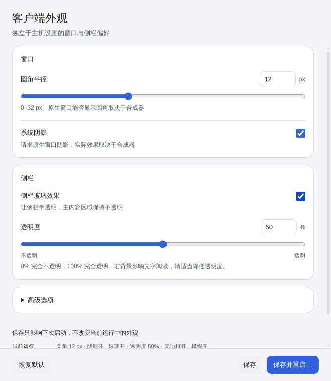

# Client appearance

[中文](client-appearance.md) | **English**

This fork’s `feature/kde-client-settings` branch provides independent window and sidebar settings. The feature is source-only; no release package containing it has been published. Older downloads from the original project do not imply support for this page’s features. See [README](../README.en.md#building-from-source) for the build entry point.



## Adjust and save

Choose “Client settings…” from the tray to adjust corners, system shadows, sidebar glass, and transparency. “Advanced” includes the frameless main window and Wayland background blur. The settings window always retains its native frame and opaque background and requests the default system shadow, independently of main-window preferences; closing it closes only that window.

The defaults require no legacy environment variables: frameless enabled, 12 px corners, system shadow enabled, sidebar glass enabled, 50% fill opacity, and Wayland blur enabled. Frameless and glass modes can run together; they are not exclusive.

“Restore defaults” fills the form without writing until you save. “Save” affects the next launch only and leaves the current window and Host tasks running. The page distinguishes current-run and next-launch values. A failed save keeps the form for correction or retry and is not reported as saved.

“Save and restart…” saves first, then opens a native confirmation. Cancel is the default. The dialog warns that running Host tasks will be interrupted and scheduled tasks cannot run during restart; only a second confirmation requests restart. Cancelling does not undo the saved preferences, which still apply at the next launch.

## Configuration file and compatible initial values

Configuration is stored separately at `app.getPath('userData')/desktop/appearance.json`, not in `$DSH_HOME`, and does not change Host configuration. Reading settings does not create a file. Saving atomically replaces the file with mode 0600 and preserves the previous file on write failure. Unknown fields, invalid JSON, invalid field types or ranges, and unsupported versions produce explicit errors without silent fallback or replacement.

A complete version-1 file:

```json
{
  "schemaVersion": 1,
  "frameless": true,
  "cornerRadius": 12,
  "systemShadow": true,
  "sidebarGlass": true,
  "sidebarOpacity": 50,
  "waylandBlur": true
}
```

`frameless`, `systemShadow`, `sidebarGlass`, and `waylandBlur` must be booleans. `cornerRadius` is an integer from 0 to 32; `sidebarOpacity` is an integer from 0 to 100. Strings and fractional numbers are rejected. UI transparency is `100 - sidebarOpacity`: 0% is fully opaque and 100% is fully transparent.

Only when the file is absent do `DSH_DESKTOP_FRAMELESS` and `DSH_DESKTOP_GLASS` supply compatible initial values: unset variables retain the defaults; an explicit value enables the option only when it is `1`. A valid integer `DSH_DESKTOP_GLASS_TINT` from 0 to 100 supplies initial fill opacity; invalid values retain the default. **Once a saved file exists, it takes precedence over these variables.** Later saves or environment changes do not mutate the loaded current-run snapshot.

If the file is invalid, back it up before repairing fields or opening it with an app version that supports its schema. Direct file edits are not applied live and also require restarting. The file rejects API keys, tokens, and other credential fields.

## Compositor support and security

Background blur, shadow v2, and transparent rounded corners have been verified on KDE Plasma 6.8.2 / Wayland, including the settings save-and-restart path. The Wayland relay requests blur and shadows through compositor protocols, while root-view clipping supplies real alpha at rounded corners. It uses the primary-runtime Python bundled under resources, not system Python.

A switch requests an effect; it does not guarantee that every desktop implements it. With native window decorations enabled, the compositor controls native corners. Compositors without the required protocols may provide transparency without blur or shadows. New effects on other compositors and X11 still need testing; successful startup of an older package does not establish appearance capabilities.

The settings window enables Electron sandbox and context isolation, disables Node integration, and exposes only `get/save/restart`. It checks the unique window, main frame, and exact local file URL. The page uses strict CSP with external scripts/styles, rejects arbitrary navigation, popups, and permissions, and does not read or transfer API credentials. These effects do not require disabling Chromium’s sandbox or changing global compositor settings.

See [the 0020 notes](../patches/README.md#独立客户端外观与-kde-wayland-效果0020) for patch dependencies and implementation scope.
